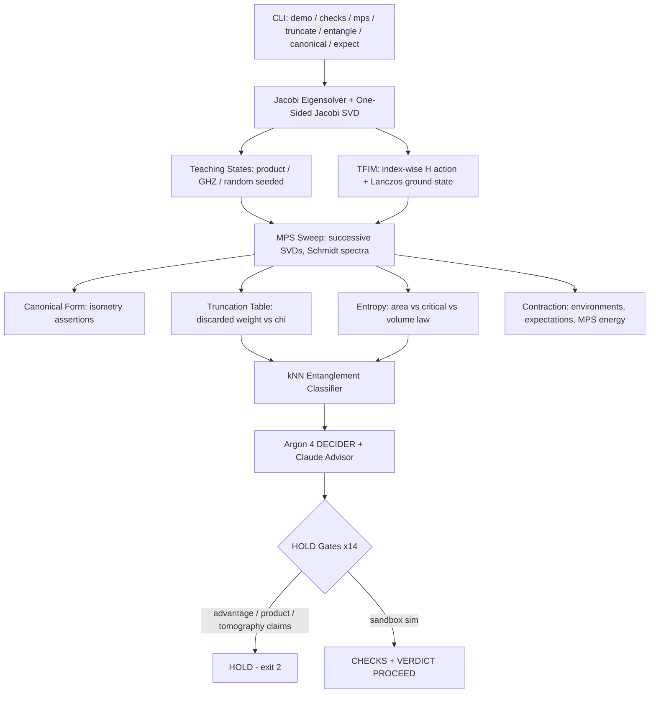
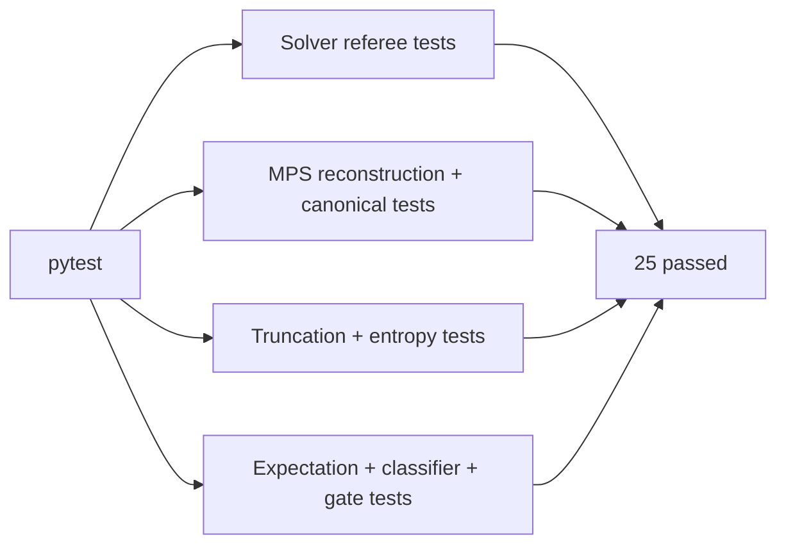
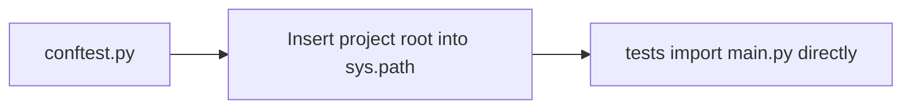
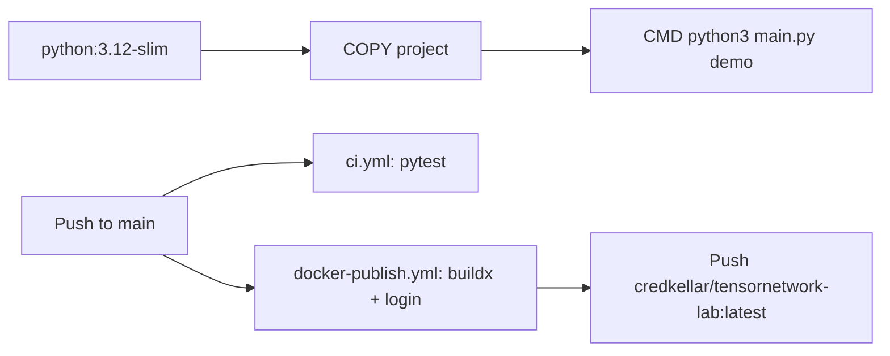

# TensorNetwork-Lab 🕸️⚛️

**Tensor Network Lab — Matrix Product States, SVD Factorisation, Truncation & the Area Law** — by Darion Kellar

TensorNetwork-Lab is an **educational tensor-network lab** in ONE pure-Python file. It takes exact statevectors of small qubit chains (N up to 10) and factorises them into **matrix product states** by successive SVDs, so the entanglement structure of a state stops being a slogan and becomes a table of numbers:

- the **factorisation view**: an MPS built by a from-scratch **one-sided Jacobi SVD** (a Gram-matrix SVD was tried first and rejected — it squared the condition number and destroyed the smallest Schmidt vectors; the story is told in the code), with reconstruction error **3.45e-14** for the TFIM ground state at full bond dimension, against a briefed bound of 1e-10;
- the **truncation view**: for the transverse-field Ising ground state (N = 10, h = 0.5, Lanczos E0 = −9.7655039579), discarded weight falls **0.959 → 1.646e-03 → 2.365e-07 → 1.145e-11** as chi runs 1 → 2 → 4 → 8, and the MPS-contraction energy follows it: error 4.766 at chi = 1, **9.756e-07 at chi = 4**, 5.318e-11 at chi = 8;
- the **entanglement view**: half-chain entropy of the gapped chain **saturates** (0.667884 → 0.688598 → 0.694158 for N = 6, 8, 10 — the area law, landing near ln 2), the critical chain creeps (0.327988 → 0.379052, log growth), and a seeded random state climbs to **2.921133** (volume law);
- the **contraction view**: expectation values and correlators computed by contracting the MPS network itself — environments, never the expanded state — matching the statevector referees to ~1e-15 (`<X_4> = 0.2605027256`, `<Z_0 Z_1> = 0.8502881895`, `<Z_2 Z_7> = 0.9213993820`).

Honest scope, stated up front: these are **small chains and exact states**. No real device was measured, no real state was tomographed, and **no quantum advantage, production simulation, or materials property is computed or claimed anywhere** — those uses are permanent HOLD gates (14 total). 🔒

[](https://github.com/kimanicollier44-cmyk/TensorNetwork-Lab/actions/workflows/ci.yml)
[](https://github.com/kimanicollier44-cmyk/TensorNetwork-Lab/actions/workflows/docker-publish.yml)

> ℹ️ These are the **live** workflow badges for this repo. They activate as soon as the `ci.yml` and `docker-publish.yml` files from the paste pack are pasted into `.github/workflows/` — until then they have nothing to report yet.

## 🧰 Tech Stack Badges & Full Architecture Tech Stack

### 💻 Core Programming Languages & Core Systems


- 🐍 Python 3.12, pure standard library (`math`, `hashlib`, `json`, `sys`) — zero dependencies, zero network, deterministic (double-run byte-identical)
- 🕸️ MPS core from scratch: a real matrix kit, a cyclic **Jacobi eigensolver** with eigenvectors, and a **one-sided Jacobi SVD** (rotations orthogonalise the columns of M itself — no Gram matrix, no squared condition number) — both refereed on known matrices before they are trusted with a state
- 🔬 Ground-state core: the TFIM action computed index-wise (diagonal ZZ + one bit flip per site), a **Lanczos** iteration with full reorthogonalisation, refereed against dense Jacobi diagonalisation at N = 4 and N = 6 (deviation 1.69e-14)
- ✂️ Truncation ledger: every SVD in the sweep reports its Schmidt spectrum and its discarded weight; the chi table prices each bond dimension in both discarded weight and MPS-contraction energy error
- 🧠 TinyML kNN entanglement classifier (from scratch, stdlib, distance-weighted): area-law / critical / volume-law from (normalised half-chain entropy, entropy growth N = 6 → 10, chi_eff), labels from the lab's own policy
- 🪑 Council seats: Gemini Argon 4 DECIDER (names-only, tighten-only) + Muse advisor (never overrides HOLD) + Google Flow plan-only (rendered = False, live = 0)

### ⛓️ Web3 & Infrastructure

- 🚫 **Not applicable — honestly.** No blockchain, no Web3, no tokens: the "infrastructure" in this lab is one offline file holding MPS tensors and Schmidt spectra. Quantum-advantage and production-simulation claims are permanent HOLD gates, not features. No fake badges here.

### ⚙️ Platform Support & Hardware Architecture


- 🖥️ Pure Python — runs anywhere Python 3.12+ runs (Linux, macOS, Windows), plus the `python:3.12-slim` Docker image
- 🔒 No hardware is controlled, ever: real qubits, state preparation, and tomography rigs are permanent HOLD gates (see the gate table below)

### ⚡ Low-Level Infrastructure & Performance

- 🚫 **No low-level code — honestly.** No C, no C++, no GPU, no compiled extensions: this is one interpreted Python file on purpose, so every Schmidt value can be read, checked, and diffed. Performance here means honest algorithms — one-sided Jacobi instead of a library SVD, staged environment contractions that stay cubic (not quartic) in the bond dimension, Lanczos instead of a dense 1024×1024 diagonalisation — all deterministic and byte-identical between runs.

### 🛠️ DevOps & Build Tools


- 🐳 Docker (`python:3.12-slim`), GitHub Actions CI + Docker Publish (delivered in the paste pack)
- 🎯 Target image: `credkellar/tensornetwork-lab:latest`
- 🧪 Tests: `pytest` (25 tests) + the built-in CHECKS suite (54 checks) in `main.py`

### ☁️ Cloud Providers

- 🚫 **None — honestly.** No cloud provider is used or needed: the lab runs fully offline on your own machine or in a local Docker container. Docker Hub appears only as the registry the publish workflow pushes the image to.

## What this does?

1. 🛠️ **Solvers, refereed before use** — a cyclic Jacobi eigensolver (known spectra: [[2,1],[1,2]] → 3, 1; the 5×5 Toeplitz matrix → 2 − 2cos(kπ/6)) and a one-sided Jacobi SVD (reconstruction of referee matrices to 3.55e-15, exact spectra for diagonal and rank-1 inputs). The lab also records *why* the obvious Gram-matrix SVD was rejected: at the TFIM middle bond it reported a smallest Schmidt value of 2.3e-11 where the true spectrum decays below 1e-17, and its "singular vectors" for the small values were not vectors of anything — the MPS tensors built from them failed the isometry test outright.
2. 🎛️ **Exact teaching states** — four states at N = 10, each chosen to make one point: a tilted **product state** (every Schmidt spectrum is (1, 0, 0, …)), the **GHZ state** (every bond carries exactly (1/√2, 1/√2), entropy ln 2), the **TFIM ground state** (from Lanczos, below), and a **seeded random state** (splitmix64, seed 20261119, printed in the demo — near-maximal entanglement).
3. ⚔️ **TFIM ground state by Lanczos** — H = −Σ Z_i Z_{i+1} − h Σ X_i on an open chain, its action computed index-wise with the full matrix never built; Lanczos with full reorthogonalisation (stated openly — without it, ghost eigenvalues corrupt small Krylov spaces) gives E0 = **−9.7655039579** at N = 10, h = 0.5, refereed against dense Jacobi diagonalisation at N = 4 and N = 6.
4. 🕸️ **MPS factorisation by successive SVDs** — the state is sliced site by site; each SVD splits off one tensor and passes ΣV^T onward. At full bond dimension the reconstruction error is **5.15e-16** (product), **0** (GHZ), **3.45e-14** (TFIM), **1.09e-14** (random) — all far under the briefed 1e-10. Schmidt values ≤ 1e-12 are dropped even at "full" chi: they carry < 1e-24 of weight each, and a zero Schmidt direction has no singular vector to keep.
5. 📐 **Canonical form, asserted** — the sweep produces a left-canonical MPS: Σ_s A[s]^T A[s] = I on every site 0..N−2, verified to **9.99e-15** worst-case across all four states, with the full MPS norm equal to 1 to 1e-12. One honest subtlety the lab prints rather than hides: the TFIM middle bond carries **32 Schmidt values but only 22 above 1e-12** — the other 10 are rounding-level zeros, so the kept bond dims are [2, 4, 8, 16, **22**, 16, 8, 4, 2], not the naive 32.
6. ✂️ **The truncation table** — capping chi at 1, 2, 4, 8, 16, 32 and re-pricing everything: discarded weight **0.959 / 1.646e-03 / 2.365e-07 / 1.145e-11 / 1.183e-20 / 1.081e-27** (monotone, asserted), and the energy — recomputed by contracting the truncated MPS, never by peeking at the statevector — errs by 4.766 / 6.442e-03 / **9.756e-07** / 5.318e-11 / ~2.4e-13 / ~2.3e-13. chi = 4 is already a 1e-6 energy; the discarded weight *is* the error budget.
7. 🌡️ **Entanglement vs system size** — half-chain entropies at N = 6, 8, 10 for three families: gapped TFIM **0.667884 / 0.688598 / 0.694158** (increments shrinking — saturation, the area law; the limit sits near ln 2 because the ordered ground state is a cat of the two ferromagnetic branches), critical TFIM **0.327988 / 0.357161 / 0.379052** (still creeping — log growth), seeded random **1.502144 / 2.303076 / 2.921133** (climbing ~ln 2 per site pair toward the 5 ln 2 ceiling — volume law).
8. 🔗 **Expectations by contraction** — left and right environments are grown tensor by tensor (staged contractions, cubic in chi), operators are inserted into the network, and the results are graded against statevector referees: `<Z_i> = 0` to 4e-15 (the chain's spin-flip symmetry, computed — not assumed), `<X_4> = 0.2605027256`, `<Z_0 Z_1> = 0.8502881895`, `<Z_2 Z_7> = 0.9213993820`, `<Z_0 Z_9> = 0.7480264652`, worst deviation ~4e-15. The full TFIM energy assembled from these local contractions matches Lanczos E0 to 2.3e-13.
9. 🏷️ **Entanglement classifier** — a from-scratch distance-weighted kNN over the lab's own policy labels state families area-law / critical / volume-law from (half-chain entropy at N = 10 normalised by 5 ln 2, entropy growth N = 6 → 10, chi_eff — the smallest tabulated chi with discarded weight < 1e-8): product, GHZ, and the gapped chain land in area-law; the critical chain in critical; the random state in volume-law; kNN == policy is asserted on every scenario and all 1,872 grid rows.
10. 🪑 **Seats + checks** — Gemini Argon 4 DECIDER (sha256 trace, tighten-only), Muse advisor, Google Flow plan-only, 14 permanent HOLD gates, and a built-in CHECKS suite (54 checks) that re-derives every headline number above.

## 🗺️ How it works — diagram per script

### `main.py` — the whole lab



### `tests/test_main.py` — verification



### `conftest.py` — test path setup



### `Dockerfile` + CI flow — container & publish



## Why is this cool?

1. 🕸️ The entanglement is **a table, not a metaphor**: every bond of every state gets its full Schmidt spectrum printed, so "this state is weakly entangled" becomes "its middle bond needs chi = 22 of 32, and here are the 10 directions that are numerically zero".
2. ✂️ Truncation is **priced in two currencies at once**: discarded weight (what the state lost) and energy error (what the physics lost), side by side for every chi — and they track each other across 11 orders of magnitude.
3. 🛠️ The SVD is **home-made and refereed**: a one-sided Jacobi routine that must first reconstruct referee matrices to 3.55e-15 and reproduce exact diagonal and rank-1 spectra before it is allowed near a statevector.
4. 📖 The lab **publishes its own failed first draft**: the Gram-matrix SVD's failure at the middle bond (fake 2.3e-11 Schmidt floor, isometry dev 1.01) is documented in the docstring, the demo, and this README — the fix (work on M itself, never M^T M) is the lesson.
5. 🌡️ The area law is **measured, not recited**: three entropy curves at three sizes each, with the gapped chain's increments visibly shrinking (0.0207, then 0.0056) while the random state adds ~0.7 per step.
6. ⚔️ Lanczos is **kept honest twice**: full reorthogonalisation stated in the open, and the result refereed against a completely independent dense diagonalisation at two sizes.
7. 🔗 Expectations are **contracted, not expanded**: the MPS never unfolds back into a statevector to answer a question — environments grow from both ends and meet at the operator, which is the entire point of the formalism.
8. 🎯 The middle-bond subtlety is **printed, not rounded away**: 32 Schmidt values, 22 real ones. A lab that reports "chi = 32" without that footnote would be lying by omission about what the state needs.
9. 🏷️ The classifier's features are **physical, not decorative**: entropy level, entropy *growth*, and the chi the state actually costs — so its verdicts (including "the critical chain is neither area- nor volume-law") can be argued with, number by number.
10. 🎯 Deterministic end to end: run it twice, get byte-identical output — a tensor-network lab you can diff.

## What problems this solves?

1. ❌ **Problem:** "MPS approximates the state" is usually asserted without an error figure. ✅ **Solution:** Reconstruction error is computed against the exact state at full chi (≤ 3.45e-14 here), and every truncation carries its discarded weight and energy error in the same table.
2. ❌ **Problem:** Textbook SVD code silently breaks on states with tiny Schmidt values. ✅ **Solution:** The Gram-matrix failure is demonstrated, explained (squared condition number), and replaced by one-sided Jacobi, with the isometry test as the tripwire that caught it.
3. ❌ **Problem:** Bond dimension is often quoted as the full Schmidt rank. ✅ **Solution:** The sweep drops rounding-level directions (≤ 1e-12) and reports the *kept* dims — 22, not 32, at the TFIM middle bond — with the tail spectrum asserted in CHECKS.
4. ❌ **Problem:** "Area law" gets repeated as a slogan for ground states. ✅ **Solution:** It is shown as data: saturation increments shrinking toward a constant, contrasted on the same axes with critical log growth and random-state volume growth.
5. ❌ **Problem:** Ground-state energies from iterative solvers are trusted on faith. ✅ **Solution:** Lanczos is refereed against dense diagonalisation at N = 4 and N = 6, and the N = 10 energy is re-derived by an independent route (direct H action, and again by MPS contraction).
6. ❌ **Problem:** MPS expectation values in tutorials often secretly expand the statevector. ✅ **Solution:** Environments are contracted tensor by tensor with staged (cubic-in-chi) contractions, and only the *referee* is allowed to touch the statevector.
7. ❌ **Problem:** Truncation error is reported for the state but not for observables. ✅ **Solution:** The energy at each chi is computed from the truncated MPS itself, so the observable-level price of each chi is explicit (9.756e-07 at chi = 4).
8. ❌ **Problem:** GHZ and product states are described as "entangled" / "not entangled" with no scale. ✅ **Solution:** Their spectra make it quantitative: (1, 0, …) at every bond vs (1/√2, 1/√2) at every bond — entropy 0 vs exactly ln 2.
9. ❌ **Problem:** Toy tensor-network code quietly becomes an advantage or product claim. ✅ **Solution:** 14 named HOLD gates (quantum advantage, tomography, production simulation, chemistry/materials products…) return exit code 2, permanently.
10. ❌ **Problem:** Simulation code with a library SVD inside can't be audited by a student. ✅ **Solution:** Every linear-algebra step — Jacobi rotations, Lanczos recurrence, environment contractions — is written out in stdlib Python in the one file.

## How to install this?

1. 📋 Clone or download this project folder.
2. 🐍 Make sure Python 3.12+ is installed: `python3 --version`
3. ▶️ Run the full demo + checks (no arguments needed):

```bash
python3 main.py
```

4. 🧪 Run the test suite:

```bash
pip install pytest
python3 -m pytest -q
```

5. 🎛️ Try the other commands:

```bash
python3 main.py checks    # 54 built-in checks
python3 main.py mps       # MPS decomposition report (JSON)
python3 main.py truncate  # discarded weight + MPS energy vs chi (JSON)
python3 main.py entangle  # half-chain entropy vs N: area / critical / volume (JSON)
python3 main.py canonical # isometry deviations + MPS norms (JSON)
python3 main.py expect    # MPS contraction expectations vs statevector (JSON)
python3 main.py classify  # kNN entanglement classifier report
python3 main.py brains    # Argon 4 + Muse + Flow seats
python3 main.py holds     # list all 14 HOLD gates
python3 main.py hold-demo # exits 2 - gated actions stay HOLD
```

6. 🐳 Or run it in Docker:

```bash
docker build -t credkellar/tensornetwork-lab:latest .
docker run --rm credkellar/tensornetwork-lab:latest
```

## Requirements

- 🐍 Python 3.12 or newer
- 📦 Dependencies: **none** (standard library only)
- 🌐 Network: **none** — fully offline
- 🧪 For tests only: `pytest`
- 🐳 Optional: Docker

## FULL project structure tree

```text
tensornetwork-lab/
├── main.py                  # the whole lab: Jacobi eigensolver, one-sided Jacobi SVD, teaching states, TFIM Lanczos, MPS sweep, truncation ledger, entropy curves, environment contractions, classifier, seats, HOLD gates
├── conftest.py              # puts the project root on sys.path for tests
├── tests/
│   └── test_main.py         # 25 pytest tests: solvers, states, Lanczos, MPS, canonical form, truncation, entropy, expectations, classifier, gates
├── assets/
│   └── cover.png            # README cover image (2736 x 912)
├── Dockerfile               # python:3.12-slim, runs the demo
├── .gitignore               # __pycache__/, .pytest_cache/, *.pyc
└── README.md                # this file
```

> 📦 Delivered separately as paste packs (not in this tree): `.github/workflows/ci.yml` + `docker-publish.yml`, and the Docker Hub pack (100-char description, 350-char About, overview, categories).

## 🔒 HOLD gates — all 14, permanent

| # | Gate | What stays held |
|---|------|-----------------|
| 1 | `quantum_advantage_claim` | No quantum-advantage or speedup claim follows from a 10-qubit teaching lab |
| 2 | `real_device_state_claim` | No claim that any MPS here describes a real device, chip, or laboratory state |
| 3 | `state_tomography_claim` | No tomographic reconstruction of any real experimental state is performed or certified |
| 4 | `error_correction_product_claim` | No error-correction product, code, or fault-tolerance claim is made or certified here |
| 5 | `production_simulation_claim` | No production, engineering, or design simulation result is produced by this lab |
| 6 | `chemistry_materials_product_claim` | No chemistry, drug, battery, or materials property is predicted or certified |
| 7 | `vendor_software_claim` | No vendor tensor-network library, platform, or benchmark figure is stated, endorsed, or compared |
| 8 | `hardware_specification_claim` | No hardware specification for any real device is asserted |
| 9 | `cryptography_claim` | No cryptographic claim follows from tensor-network mathematics |
| 10 | `machine_learning_product_claim` | No machine-learning product, model, or accuracy claim is made here |
| 11 | `certification_claim` | No certification that any system meets any standard |
| 12 | `investment_claim` | No investment claim; a lab model is not a prospectus |
| 13 | `live_hardware_control` | No control of real qubits, links, or laboratory hardware, ever |
| 14 | `model_as_measurement_claim` | A computed number is a statement about the model at stated inputs, never a measurement |

🧑‍⚖️ **Council seats:** Gemini Argon 4 Extended Thinking — DECIDER (names-only, tighten-only, MAP → MODEL → STRESS → DECIDE, sha256 trace, `can_override_hold = False`) · Muse — advisor (`can_override_hold = False`) · Google Flow — plan-only (`rendered = False`, `live = 0`).

✅ **Verification:** pytest **25 passed** (project + clean copy) · built-in CHECKS **54/54** · double-run output **byte-identical** · `hold-demo` exits **2** · `main.py` **1,255 lines**, pure stdlib, zero network.

## 🧒 5th-grade English section

Imagine a **crowd photo** of 10 friends standing in a line, where every friend can be in two poses. Writing down the whole photo the normal way means listing 1,024 pose combinations — and for 50 friends the list would be longer than the universe. 📸

- A **matrix product state** is a smarter notebook: instead of the whole photo, you keep one small page per friend, plus a short note about how each friend is *linked* to the next one. If the friends are barely linked, the notes stay tiny and the notebook is thin. That link-note size is called the **bond dimension**, chi. 📓
- The links are found by a maths knife called the **SVD**, which this lab builds from scratch — its first knife (an easier design) actually broke on the faintest links, so the lab shows you the broken knife, explains why it broke, and uses a stronger one. 🔪
- **Entanglement** is how strongly the friends' poses are linked. This lab measures it with a number: a chain of magnets settling into its quietest state has links that **stop growing** as you add friends (the "area law"), while a totally random photo's links **grow and grow** — its notebook would be as thick as the photo itself. 🧲
- If you force the notebook thinner than it wants to be (**truncation**), you throw away the faintest links. The lab weighs exactly what was thrown away and shows how much the answer moves — like erasing the faintest pencil lines and checking the drawing still looks right. ✏️
- Questions about the photo — "is friend 5 pointing up?" — are answered **from the notebook pages**, passing notes along the line, never by re-printing the whole giant photo. 💬
- This project is a **pretend lab on a computer**. It does not touch a real quantum computer. It teaches how scientists squash enormous quantum states into notebooks small enough to think with. 💻

---

MIT © 2026 Darion Kellar · TensorNetwork-Lab — educational simulation only 🕸️
